<picture>
  <source media="(prefers-color-scheme: dark)" srcset="assets/banner-dark.svg">
  
</picture>

Flutter와 Kotlin·Swift로 모바일 앱을 만들고, 네이티브 연동과 여러 기기 통합 테스트를 주로 다룹니다.

I build Flutter apps where Dart meets the platform: native modules in Kotlin and Swift, location and permission flows on Android and iOS, in-app purchases, and integration tests that run on several devices at once.

### 📱 What I work on

<table>
  <tr>
    <td width="50%" valign="top">
      <b>🔌 Native modules</b> 
      Pigeon and platform channels, with Kotlin on Android and Swift on iOS.
    </td>
    <td width="50%" valign="top">
      <b>📍 Location and permissions</b> 
      Background location and permission flows that differ between Android and iOS versions.
    </td>
  </tr>
  <tr>
    <td width="50%" valign="top">
      <b>🧪 Integration tests</b> 
      Patrol and <code>flutter test</code> on emulators, simulators and real devices, including two devices talking to each other.
    </td>
    <td width="50%" valign="top">
      <b>🚀 Store releases</b> 
      Shipping to Google Play and the App Store.
    </td>
  </tr>
</table>

### 🧩 Open source

| Project | What I did | Status |
|---|---|---|
| [permission_handler](https://github.com/Baseflow/flutter-permission-handler) | iOS: report `locationAlways` as denied until Always has been requested ([#1577](https://github.com/Baseflow/flutter-permission-handler/pull/1577)) |  released in 9.6.4 |
| [patrol](https://github.com/leancodepl/patrol) | Show the real error for tests that fail in profile and release mode ([#3325](https://github.com/leancodepl/patrol/pull/3325)) |  |
| [patrol](https://github.com/leancodepl/patrol) | Add R8 consumer rules so release-mode Android tests keep the test runner ([#3334](https://github.com/leancodepl/patrol/pull/3334)) |  |
| [patrol](https://github.com/leancodepl/patrol) | Make the example build on Flutter 3.47 ([#3335](https://github.com/leancodepl/patrol/pull/3335)) |  |
| [flutter/packages](https://github.com/flutter/packages) | in_app_purchase: document base plans and offers on Android ([#13396](https://github.com/flutter/packages/pull/13396)) |  |
| [permission_handler](https://github.com/Baseflow/flutter-permission-handler) | Reproduced iOS location requests that return before the user answers, and proposed a fix ([#1152](https://github.com/Baseflow/flutter-permission-handler/issues/1152#issuecomment-6459785546)) |  |
| [pigeon](https://github.com/flutter/packages/tree/main/packages/pigeon) | Proposed default values for data classes, with the implementation ready on a branch ([flutter#161797](https://github.com/flutter/flutter/issues/161797)) |  |

### 🧰 Tools

  
  
  
  
  
  
  
  
  
  
  
  
  
  

Status badges update from GitHub. Last edited October 2026.
